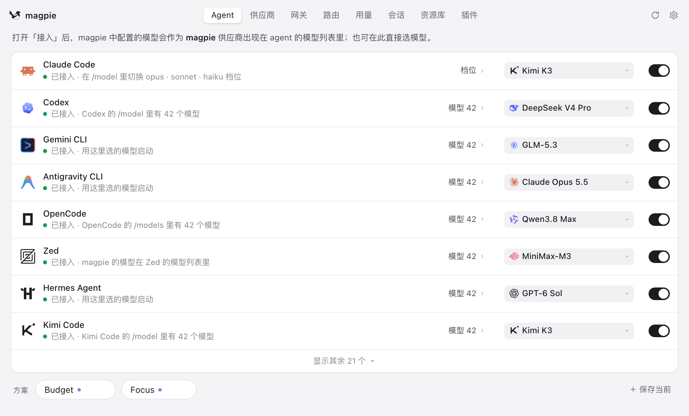

<div align="center">

<a href="https://usemagpie.ai/zh/"></a>

# magpie

### 所有 Agent 的模型，一处搞定。

**Claude Code 跑 Kimi，Codex 跑 DeepSeek，Gemini CLI 跑 GLM，OpenCode 用你的 ChatGPT 订阅。**<br>
在菜单栏一点就能切换。所有 Agent 共用一个本地网关，<br>
额度用完时，它会悄悄切到你的下一个账号。

[](https://github.com/yetone/magpie-releases/releases/latest) [](https://github.com/yetone/magpie/stargazers) [](https://discord.gg/vGSnD3ZKQF) [](LICENSE)<br>
    

Thanks to [Kimi](https://usemagpie.ai/go/kimi-cn/readme) for supporting magpie and the open source community.

<sub>赞助商</sub>

<a href="https://usemagpie.ai/go/apinebula/readme"><picture><source media="(prefers-color-scheme: dark)" srcset="site/public/img/sponsor-apinebula-dark.svg"></picture></a>&emsp;&emsp;<a href="https://usemagpie.ai/go/zerotoken/readme"><picture><source media="(prefers-color-scheme: dark)" srcset="site/public/img/sponsor-zerotoken-dark.svg"></picture></a>&emsp;&emsp;<a href="https://usemagpie.ai/go/apikeyfan/readme"><picture><source media="(prefers-color-scheme: dark)" srcset="site/public/img/sponsor-apikeyfan-cn-dark.svg"></picture></a><br>
<a href="https://usemagpie.ai/go/wandapi/readme"><picture><source media="(prefers-color-scheme: dark)" srcset="site/public/img/sponsor-wandapi-cn-dark.svg"></picture></a>&emsp;&emsp;<a href="https://usemagpie.ai/go/aigocode/readme"><picture><source media="(prefers-color-scheme: dark)" srcset="site/public/img/sponsor-aigocode-readme-dark.png"></picture></a>

**[下载](https://usemagpie.ai/zh/)** &nbsp;·&nbsp; **[文档](https://usemagpie.ai/docs/zh/start)** &nbsp;·&nbsp; **[完整参考（英文）](docs/reference.md)** &nbsp;·&nbsp; **[插件](https://github.com/magpie-community/plugins)** &nbsp;·&nbsp; **[Discord](https://discord.gg/vGSnD3ZKQF)** &nbsp;·&nbsp; [English](README.md) · **简体中文**

<br>

<picture>
  <source media="(prefers-color-scheme: dark)" srcset="site/public/img/agents-zh-dark.png">
  
</picture>

</div>

<br>

## magpie 适合你吗？

每个 Agent 都把模型写在自己的配置文件里，格式各不相同，key 和 base URL 各管各的。花钱买的订阅只能在一个 Agent 里用。magpie 把这些收进一个应用和一个本地网关：

- **任意 Agent 用任意模型**，在一张表里选。magpie 只改 Agent 配置里该改的那一个键。
- **一个 provider 处处能用**：API key、本地模型，或者你登录着的 Claude、ChatGPT、Copilot、Gemini、Grok 订阅。
- **额度用完也不断**：同一个服务商的下一个账号自动接上，路由组还能换到别的模型或服务商，Agent 看不到报错。只有一个账号又没建路由组时，没有可换的，报错会原样回给 Agent。
- **密钥不出你的电脑**：在 **设置 → 隐私** 打开脱敏后（默认关闭），提示词里的密钥、密码、邮箱，在请求离开电脑前就在本地脱敏，回复里再换回原值。

如果你用不止一个 Agent、不止一个 provider 或不止一个账号，它就适合你。如果你只用一个 Agent、只用它自家的订阅，而且够用，那就不需要 magpie。

支持 macOS、Windows 和 Linux（菜单栏应用、窗口、TUI、Web 界面和 CLI），也能跑在 Docker 和 Termux 上。

## 快速开始

**1 · 安装**。从 **[usemagpie.ai](https://usemagpie.ai/zh/)** 下载应用，或者运行：

```sh
curl -fsSL https://usemagpie.ai/install.sh | sh
```

<sub>Mac 版已签名并公证，每个版本都会自动更新。Linux 上脚本装桌面版，桌面上没装 WebKitGTK 4.1 时会先用系统的包管理器装上（sudo 会要密码）；没有桌面或没有终端可问时装终端版，并告诉你该装哪个包。用 `--gui` 或 `--tui` 可以自己选。网络受限时可用 `--proxy` 或 `--mirror`。也可以 `go install github.com/yetone/magpie@latest`，或者用 [Docker 镜像](https://usemagpie.ai/docs/zh/docker)。 用 `curl -fsSL https://usemagpie.ai/install.sh | sh -s -- --uninstall` 卸载：先把 Agent 恢复成原来的配置，再拿掉脚本装上的东西（magpie 已被删掉时会临时下载一个来恢复）；`~/.config/magpie` 里的设置会保留，加 `--purge` 才一起删除。</sub>

**2 · 添加 provider**。打开 magpie，进入 **Providers → 添加 provider**。选一个预设、粘贴 key，或者登录一个订阅。

**3 · 选模型**。在 **Agents** 页给每个 Agent 选一个模型。开一个新会话就用上了。

也可以全程在终端里操作：

```sh
magpie provider add deepseek sk-…              # 预设只需要 key
magpie claude deepseek/deepseek-v4-pro          # Claude Code 用 DeepSeek
magpie codex moonshot/kimi-k2.5                 # Codex 用 Kimi
magpie group add "Opus anywhere" models=claude/claude-opus-5-5,copilot/claude-opus-5.5 routing=smart
magpie claude group/opus-anywhere               # 在多个订阅间自动切换
magpie save work && magpie use work             # 方案
magpie quota                                    # 每个套餐还剩多少
magpie settings set theme dark                  # 设置里的每一项，也能在终端改
magpie tool generate_image "一只喜鹊，水彩" -o hero.png   # 直接调用 magpie 的生图、识图、搜索工具
magpie tui                                      # 全部功能，在终端里
```

magpie 通过读取智能体的登录信息（Claude Code 和 Codex 的文件、钥匙串）找到它们登录的订阅。不想让它读取，可以在 设置 → 隐私 里关闭「订阅账号」，或运行 `magpie accounts discovery off`（`on` 重新开启）。`MAGPIE_NO_ACCOUNTS=1` 只对这一次运行关闭，不改动保存的设置。API Key 服务商不受影响。

## 支持的 Agent

<table>
<tr><td>

Claude Code · Claude Desktop · Claude Science · Codex · Gemini CLI · Antigravity CLI · OpenCode · OpenChamber · MiMo Code · DevEco Code · Pi · oh-my-pi · StepCode · MothX · PenguinHarness · Aside · OmO · Prime Agent · Goose · Cursor CLI · Cursor Private Inference · Zed · VS Code Chat · VS Code Insiders · VSCodium Chat · Zoo Code · JetBrains Air · Air (JetBrains IDEs) · Copilot (JetBrains) · Copilot CLI · Crush · DeepSeek Harness · Reasonix Studio · Command Code · fx · Devin · Hermes Agent · Mister Morph · Kimi Code · jcode · Qwen Code · Muse Code · Empryo · MiniMax Code · Droid · Cline · Qoder · Qoder CN · Grok Build · Grok App · ZCode · WorkBuddy · WorkBuddy AI · CodeBuddy · Pencil · OpenPencil · OpenBot · NewMax · LiveAgent · Raycast · Kiro Crew · OpenMausBot · T3 Code · OpenHanako · AtomCode · Snow CLI · Alma · Cindy · Lody · AionUi · Cherry Studio · Ante · AstrBot · QwenPaw · OpenClaw

</td></tr>
</table>

magpie 只显示你电脑上装了的 Agent；部分 Agent 的配置说明见[参考文档](docs/reference.md#notes-on-some-agents)（英文）。其他任何能填 base URL 的工具也都能用这个网关：

```sh
export OPENAI_BASE_URL=http://127.0.0.1:3425/v1     OPENAI_API_KEY=magpie
export ANTHROPIC_BASE_URL=http://127.0.0.1:3425     ANTHROPIC_API_KEY=magpie
export GOOGLE_GEMINI_BASE_URL=http://127.0.0.1:3425 GEMINI_API_KEY=magpie
```

## 整体结构

`127.0.0.1:3425` 上的网关同时支持 OpenAI Chat、OpenAI Responses、Anthropic Messages 和 Gemini，并在它们之间互相转换，流式输出、工具调用和推理都支持。

<picture>
  <source media="(prefers-color-scheme: dark)" srcset="site/public/img/architecture-zh-dark.svg">
  
</picture>


## 功能

### 任意模型，任意 Agent

点一下模型，弹出可搜索的列表：你添加的每个 provider 的每个模型，格式是 `provider/model`。选中后 magpie 原子地改写 Agent 的配置，注释、顺序和格式原样保留。**方案**（Profile）把所有 Agent 的配置存成一个名字，比如「省钱」「专注」，一键全部切回去。每个 Agent 还可以有自己的常用模型短名单，方案也会一并保存。

<table>
<tr>
<td width="50%">
<picture>
  <source media="(prefers-color-scheme: dark)" srcset="site/public/img/panel-dark.png">
  
</picture>
</td>
<td width="50%">
<picture>
  <source media="(prefers-color-scheme: dark)" srcset="site/public/img/picker-dark.png">
  
</picture>
</td>
</tr>
</table>

### 隐私脱敏

Agent 会把读到的东西放进提示词：一个 `.env`、一份配置、一段带 token 的日志。打开脱敏后，请求离开电脑前，magpie 在本地把这些值换成占位符，回复里再换回来。Agent 和你的文件里始终是真值，厂商一个也看不到。

<picture>
  <source media="(prefers-color-scheme: dark)" srcset="site/public/img/masking-zh-dark.png">
  
</picture>

| | |
| :-- | :-- |
| **两种方式找** | 规则管确定的：API key、私钥、token、邮箱，以及校验位对得上的银行卡号和证件号；需要的话，再加一个在这台电脑上运行的模型，找规则找不到的人名、地址和密码（下载 1.6 GB，用 CPU 跑） |
| **处处换回** | 值变成 `{{API_KEY_k3v9x2mq}}` 这样的占位符，回复里的占位符都换回原值，流式文本和工具调用参数也算，所以 Agent 执行的命令里是真的 key |
| **什么都不坏** | 同一个值每次的占位符都一样，对话上下文、提示词缓存和 thinking 签名都不受影响。一个值遮过一次，以后出现在哪里都会遮 |
| **从不落盘** | 原值只在内存里。记录只留每个值的类型、长度和开头几个字符。脱敏打开却运行不了时，请求会被拦下（503），绝不按原样发出 |
| **看得见** | **观测 › 脱敏** 列出它改过的每个请求，厂商实际收到了什么，左右对照；设置里的 **试一试** 能看一段文字会变成什么 |
| **你说了算** | 机密和个人信息各自开关，更细的类型（护照、IBAN、MAC、公网 IP…），自己的词和规则，以及找到值后是 **脱敏**、只 **提醒**，还是 **拦截** |

代价：模型看到的是 `{{API_KEY_…}}` 而不是 key，所以针对值本身的任务（比如这个 token 为什么被拒）没法做，这类值可以加进 **从不脱敏**。规则偶尔会判错，在脱敏页一眼就能看到。默认关闭，在 **设置 → 隐私** 里打开。专门留作示例的域名（`example.com`、`.test`、`.invalid`）下的邮箱不会脱敏。

### Provider

选一个预设，粘贴 key。模型列表直接来自厂商，名称和推理档位从 [models.dev](https://models.dev) 补全，今天早上刚发布的模型，下次刷新就出现在你的选择器里。

> **预设包括** Anthropic · OpenAI · Google Gemini · Amazon Bedrock（runtime 与 Mantle）· DeepSeek · Kimi · 智谱 GLM · MiniMax · 阶跃星辰 · LongCat · 通义千问 · 百度千帆 · 腾讯云 · 华为云 MaaS · 火山方舟 · Mistral · Voyage AI · Groq · Nous Portal · xAI · OpenRouter · Together · Fireworks · 硅基流动 · NVIDIA NIM · 魔搭 · Ollama · LM Studio …… 以及任何兼容 OpenAI 或 Anthropic 的地址。

**导入**能读取你在 CC Switch、Claude Code、Codex 和 Alma 里配置的 provider。[**「添加到 magpie」链接**](https://usemagpie.ai/docs/zh/import)让 provider 网站一键把配置交给 magpie。每个 key 和每个账号都可以走自己的代理。

<picture>
  <source media="(prefers-color-scheme: dark)" srcset="site/public/img/add-zh-dark.png">
  
</picture>

### 订阅

你登录过的 Agent 背后就是一个带模型的订阅，magpie 把它当成 provider 给其他所有 Agent 用。每个订阅可以加多个账号，magpie 会在它们之间自动切换。

- **Claude**：驱动本机真正的 `claude` 程序，通过 MCP 桥接你的 Agent 的工具
- **Codex / ChatGPT**：你的 ChatGPT 订阅里的模型，给所有其他 Agent 用
- **GitHub Copilot**、**Gemini（Code Assist）**、**Antigravity**、**Grok（SuperGrok）** 等等
- **任何 OpenCode 登录插件或 pi 包**，直接从 npm 安装

**每日预热**会在你选定的时间，或者上一个窗口刚重置时，启动每个 Claude 和 ChatGPT 账号的 5 小时窗口。

### 路由组

**路由组**是 Agent 当作一个模型来选的一组模型，比如 `group/daily-coding`。网关会把请求分摊到每个成员的 key 和账号上：

| 模式 | 作用 |
| :-- | :-- |
| **`smart`** | 在还有额度的订阅里，优先用最快重置的那个，重置时浪费得最少 |
| **`order`** | 先用第一个模型，它答不了再用下一个 |
| **`rotate`** | 每一轮换下一个成员 |
| **`usage`** | 优先用用得最少的成员 |
| **`pace`** | 优先用距离重置前每小时剩余周额度最多的账号 |

只要厂商的提示词缓存还值得保留，**对话就留在回答它的那个账号上**。路由组可以嵌套。[**意图路由**](https://usemagpie.ai/docs/zh/intent)由你选的一个小模型读每一轮新消息，写测试交给强模型，简单问题交给便宜的模型。路由页实时展示每一次决策。

<picture>
  <source media="(prefers-color-scheme: dark)" srcset="site/public/img/routing-zh-dark.png">
  
</picture>

<table>
<tr>
<td width="50%">
<picture>
  <source media="(prefers-color-scheme: dark)" srcset="site/public/img/intent-trace-zh-dark.png">
  
</picture>
</td>
<td width="50%">
<picture>
  <source media="(prefers-color-scheme: dark)" srcset="site/public/img/nested-routing-zh-dark.png">
  
</picture>
</td>
</tr>
</table>

### 插件

```sh
magpie plugin add opencode-gemini-auth   # npm 上的 OpenCode 插件
magpie plugin add pi-antigravity         # pi 包，同样的方式
magpie plugin login google-plugin        # 在 magpie 里走它自己的登录流程
```

插件运行在 [Bun](https://bun.sh) 上，第一次需要时自动下载。插件负责登录、列出模型和发送请求，Agent 像用其他 provider 一样用它的模型。去 **[magpie-community/plugins](https://github.com/magpie-community/plugins)** 逛逛，或者[自己写一个](https://usemagpie.ai/docs/zh/plugins)。

插件还可以是**网关中间件**：一段 JavaScript，能看到每个 Agent 发出和收到的内容。`onRequest` 可以改写或拒绝请求，`onEvent` 看到每个流式事件，`onResponse` 看到完整回复。钩子抛错或超时，请求原样放行。

```js
// alias.middleware.js — magpie plugin add ./alias.middleware.js
export function onRequest(body, ctx) {
  if (body.model === "fast") return { ...body, model: "deepseek/deepseek-chat" };
}
```

<details>
<summary><b>现成的中间件</b>，大多对应 <a href="https://github.com/QuantumNous/new-api">New API</a> 给渠道做的事，JSON 格式也一样</summary>

<br>

| 包 | 作用 |
| :-- | :-- |
| `param-override` | New API 的 `param_override`：按条件设置、删除、移动或改写请求字段，或拒绝请求 |
| `model-map` | New API 的 `model_mapping`：把模型换个名字发出去，回复里仍是原来请求的名字 |
| `system-prompt` | 给所有请求，或某些 Agent、某些模型的请求加上你的系统提示词 |
| `word-guard` | New API 的敏感词过滤：在用户发送的内容和回复里拒绝或屏蔽敏感词 |
| `think-tags` | 去掉回复里的 `<think>…</think>`，或把 `reasoning_content` 放进回复 |

```sh
magpie plugin add @magpie-community/middleware-model-map
magpie plugin options model-map '{"mapping": {"fast": "deepseek/deepseek-chat"}}'
```

在「插件 › 发现 › 网关中间件」里可以找到它们。详见[网关中间件](https://usemagpie.ai/docs/zh/plugins#middleware)。

</details>

### 用量和花费

<picture>
  <source media="(prefers-color-scheme: dark)" srcset="site/public/img/usage-zh-dark.png">
  
</picture>

| | |
| :-- | :-- |
| **token 和花费** | token、缓存读写、推理和调用次数，按官方价格算花费，美元或人民币；任何模型都能自定义价格 |
| **额度** | 每个 key、套餐和账号的余额和额度窗口（`magpie quota`），窗口还剩很多就要重置时提醒你 |
| **会话** | 每个 Agent 对话的花费和标题，一键在终端里重新打开 |
| **上下文** | 每个请求的上下文窗口用了多满、多少来自缓存、被什么占着 |
| **账单** | 按账号、按上游 key 统计，还能 OTLP 导出到你自己的可观测性系统 |

### 共享

| | |
| :-- | :-- |
| **局域网** | 打开「局域网共享」，给每个客户端一个命名的网关 key，各自设每天、每周或每月的 token 和花费上限 |
| **[远程 magpie](https://usemagpie.ai/docs/zh/remote)** | 笔记本用台式机上那个 magpie 的 provider、账号和路由组，同时照样配置自己的 Agent |
| **[Docker](https://usemagpie.ai/docs/zh/docker)** | 在服务器或 NAS 上跑 `ghcr.io/yetone/magpie`，用 Web 界面管理 |
| **同步** | 备份到文件，或者通过 WebDAV（坚果云、Nextcloud……）或 S3 在多台机器间同步 |

### 还有

- **资料库**：指令、MCP 服务器、技能和子代理只写一次，magpie 按每个 Agent 的格式写进它的文件，删除时只删自己写的部分。
- **任何模型都能联网搜索**：不能搜索的模型由 magpie 代为搜索，用能搜索的 provider 或搜索 API（Tavily、Brave、Exa、Firecrawl、You.com、DeepSeek、火山引擎豆包搜索、腾讯云元宝搜索、SearXNG），按你拖好的顺序调用，每个都能单独关闭而不删除密钥。一个 API 可以填多个密钥：搜索默认轮流使用（`pick=order` 则按顺序），最近被拒的密钥最后才用；Tavily 的每个密钥用了多少额度，在设置页和 `magpie search` 里都能看到。任何 Agent 都能把同一个搜索挂成 MCP 服务器，提供 `web_search` 工具和按 URL 读取网页的 `web_fetch` 工具。
- **图片和视频**：通过 MCP 给任何 Agent 一个生图工具，用你选的模型；有 Grok 订阅或 MiniMax API Key（MiniMax H3）还能生成视频。
- **Agent 保持最新**：Agents 页显示每个 CLI 的版本，按当初的安装方式更新，没装的也给出安装命令。
- **WSL**：在 Windows 上，WSL 发行版里的 Agent 一样能配置，会话也一样统计。
- **保持唤醒**、浅色和深色，在 [Omarchy](https://omarchy.org) 上跟随你的主题。

## 文档

| | |
| :-- | :-- |
| **[快速上手](https://usemagpie.ai/docs/zh/start)** | 入门导览 |
| **[完整参考](docs/reference.md)**（英文） | 每个 Agent、provider 选项、网关接口、CLI 命令和文件 |
| **[插件](https://usemagpie.ai/docs/zh/plugins)** | 使用插件和编写插件 |
| **[意图路由](https://usemagpie.ai/docs/zh/intent)** | 按每轮对话的内容选择模型 |
| **[导入链接](https://usemagpie.ai/docs/zh/import)** | 给 provider 网站用的「添加到 magpie」按钮 |
| **[远程 magpie](https://usemagpie.ai/docs/zh/remote)** | 在其他电脑上用同一个 magpie 的 provider 和路由组 |
| **[Docker](https://usemagpie.ai/docs/zh/docker)** | 在服务器或 NAS 上运行 magpie |

## 隐私

你的提示词、回复、密钥和账号只发给你用的供应商；打开[隐私脱敏](#隐私脱敏)后，其中的密钥连供应商也收不到。正式版 magpie 每天告诉我们一次它在用：一个随机 ID、版本和系统，以及用了哪些 agent、供应商和模型，只用 magpie 自己的 ID（你自己添加的供应商只记作 `custom`），以及添加供应商页里排在最前的合作伙伴每天被展示、打开和添加的次数（只有次数）。不发送名称、URL、账号、密钥、提示词和用量。可以在 **设置 → 隐私** 里关掉一部分或全部，也可以设 `DO_NOT_TRACK=1`。合作伙伴的官网和获取 Key 链接经 `usemagpie.ai/go/…` 跳转并计一次点击，usemagpie.ai 也统计合作伙伴列表的拉取次数；这是服务器本身看到的，不受设置影响，不记录 ID 和 IP。插件、导入链接和库里的图标经 `usemagpie.ai/api/icon` 获取，图标所在的服务器只看到 Cloudflare 的地址，看不到你的 IP；这台服务器只转发图片，不计数也不记录。[隐私页](https://usemagpie.ai/docs/zh/privacy)列出了 magpie 自己发出的所有内容，附示例和每个开关；规则见[参考文档](docs/reference.md#counting-users)。

## 社区

有问题、有想法，或者某个模型就是不出现？请到 **[Discord](https://discord.gg/vGSnD3ZKQF)** 反馈。

**本仓库不接受 Pull Request**，只有维护者能提交。想要修复或新功能，请在 Discord 里描述清楚，我们来实现。

如果 magpie 帮你少改了一次配置文件，**点个 ⭐ 能让更多人发现它。**

<a href="https://star-history.com/#yetone/magpie&Date">
  <picture>
    <source media="(prefers-color-scheme: dark)" srcset="https://api.star-history.com/svg?repos=yetone/magpie&type=Date&theme=dark">
    
  </picture>
</a>

## 许可证

[MIT](LICENSE)

magpie 与 [Apache Magpie](https://magpie.apache.org) 及 [Apache 软件基金会](https://apache.org)没有隶属关系。
